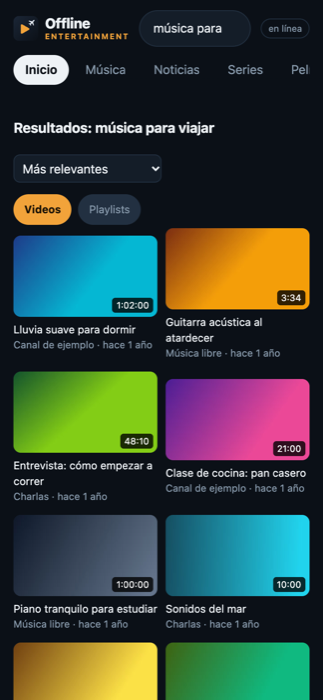
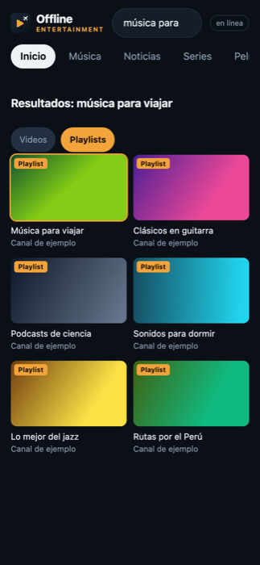
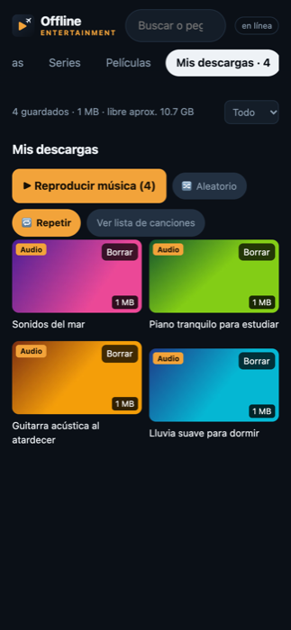
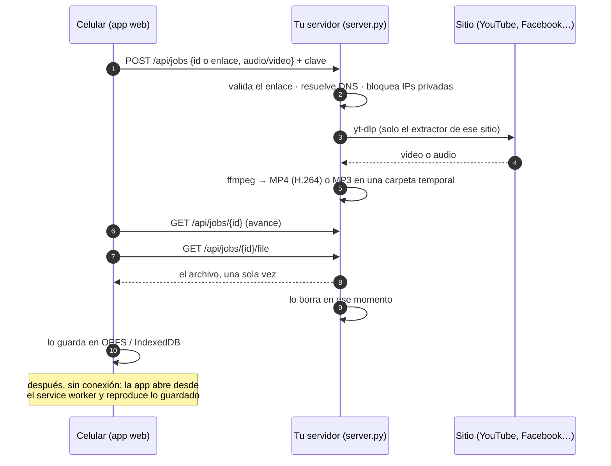
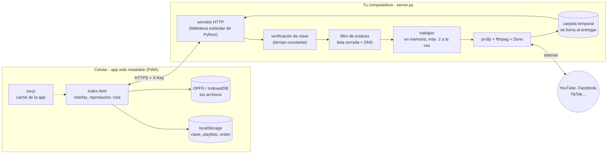

<p align="center">
  
</p>

<p align="center">
  <b>Tu propio entretenimiento de avión.</b><br>
  Guarda videos y música en tu celular y míralos en modo avión.
</p>

<p align="center">
  <a href="https://github.com/azweig/offline-entertainment/actions/workflows/ci.yml"></a>
  <a href="https://github.com/azweig/offline-entertainment/actions/workflows/codeql.yml"></a>
  <a href="docs/security.md"></a>
  <a href="LICENSE"></a>
  
  
</p>

<p align="center"><a href="README.md">English</a> · <b>Español</b></p>

<p align="center">
  
  
  
</p>

Offline Entertainment es una app pequeña que corres en **tu propia computadora** o en **tu servidor de
casa**. Desde el celular buscas o pegas un enlace, y el video o la canción se guarda **dentro del
navegador de tu celular**. Después, en el avión, en el bus o donde no haya señal, abres la app y todo
se reproduce sin conexión.

Sin cuentas. Sin servicios centrales. Sin intermediarios. El servidor no guarda nada.

---

## Contenido

- [Documentación](#documentación)
- [Funciones](#funciones)
- [Sitios compatibles](#sitios-compatibles)
- [Instalación rápida](#instalación-rápida)
- [Usarla desde el celular](#usarla-desde-el-celular)
- [Cómo funciona](#cómo-funciona)
- [Arquitectura](#arquitectura)
- [Seguridad y privacidad](#seguridad-y-privacidad)
- [Configuración](#configuración)
- [Actualizar yt-dlp](#actualizar-yt-dlp)
- [Limitaciones](#limitaciones)
- [Aviso de uso](#aviso-de-uso)
- [Contribuir](#contribuir) · [Créditos](#créditos) · [Licencia](#licencia)

## Documentación

La documentación técnica está en inglés, como es habitual en proyectos open source.

| Guía | Qué tiene |
|---|---|
| [Instalación propia](docs/self-hosting.md) | Docker, systemd, Tailscale, proxy inverso (Caddy/nginx), claves, lista de seguridad |
| [Arquitectura](docs/architecture.md) | Diagramas C4 (contexto, contenedores, componentes), UML de clases, secuencias y estados, dónde se guarda cada dato, límites |
| [API HTTP](docs/api.md) · [OpenAPI](docs/openapi.yaml) | Cada endpoint, parámetros, errores y un ejemplo con curl |
| [Seguridad](docs/security.md) | Modelo de amenazas (STRIDE), controles enlazados al código y a las pruebas, revisión de seguridad, riesgos que quedan |
| [Desarrollo](docs/development.md) | Preparar el entorno, comandos `make`, convenciones, sumar un sitio, publicar versiones |
| [Problemas frecuentes](docs/troubleshooting.md) | Errores comunes y preguntas frecuentes |
| [Decisiones (ADR)](docs/adr/) | Por qué está hecho así |
| [Cambios](CHANGELOG.md) · [Política de seguridad](SECURITY.md) · [Contribuir](CONTRIBUTING.md) | |

## Funciones

**Encontrar qué guardar**
- Búsqueda en YouTube con dos pestañas, **Videos** y **Playlists**, y orden por más nuevos o más antiguos.
- Inicio con filas de Música, Noticias, Series y Películas, y **Para ti**: sugerencias según lo que ya
  guardaste (sin cuenta).
- Ficha antes de guardar: fecha de publicación, vistas, duración y descripción.
- Pega un enlace de YouTube o de [otros 10 sitios](#sitios-compatibles): Facebook, Instagram, TikTok, X y más.
- Pega una playlist, un álbum o un artista público de **Spotify**: la app lee la lista de canciones y
  guarda cada una desde YouTube Music.

**Guardar**
- Video (360p, 480p o 720p, MP4 H.264 que se reproduce en iPhone y Android) o solo audio (MP3).
- Playlists o artistas completos de YouTube en audio con un toque. La cola sobrevive si recargas,
  reintenta si el servidor está ocupado y salta lo que falla.
- Videos largos sin problema: el único tope es 1,2 GB por archivo.

**Ver sin conexión**
- Sin internet, la app abre directo en **Mis descargas**, en unos 30 ms.
- Reproductor de música que funciona como playlist: reproducción continua, aleatorio, repetir, tu
  propio orden y controles en la pantalla bloqueada. Salta las canciones dañadas.
- Tus propias playlists, filtro por playlist y "bajar las que faltan".
- Borrar cualquier cosa siempre pide confirmación.
- **Escucha como en los 90 (📼):** un reproductor flotante con la forma de los clásicos de escritorio
  (ventana principal, ecualizador de 10 bandas y lista) que se arrastra, se pega, se achica y se
  minimiza mientras sigues navegando; la música nunca se corta. Se dibuja con **skins clásicos de
  Winamp 2 (.wsz)**: sube los tuyos o corre `make skins` una vez para buscar en todo el catálogo del
  [Winamp Skin Museum](https://skins.webamp.org/) (más de 100.000, por nombre o categoría, sin
  contenido +18). Cada skin se baja solo al elegirlo y queda en el dispositivo. No se incluyen skins de
  terceros. El ecualizador cambia el sonido en la compu; en el celular es visual para que la música
  siga con la pantalla bloqueada.

**Seis idiomas**
- Español, English, Português, 中文, Русский y 日本語, según el navegador y cambiable con 🌐. Las
  fechas siguen el idioma y las filas de Inicio buscan en YouTube en ese idioma.

## Sitios compatibles

| Sitio | Qué puedes pegar |
|---|---|
| YouTube | Búsqueda, videos, Shorts, playlists y canales |
| Facebook | Videos y reels públicos |
| Instagram | Reels y publicaciones públicas (de un carrusel se guarda el primero) |
| TikTok | Videos públicos |
| X (Twitter) | Posts públicos con video |
| Vimeo | Videos públicos que no piden iniciar sesión |
| SoundCloud | Canciones sueltas |
| Dailymotion | Videos |
| Twitch | Clips y transmisiones pasadas (no en vivo) |
| Bandcamp | Canciones sueltas |
| Internet Archive | Videos y audios |
| Spotify | Playlists públicas (primeras 100 canciones), álbumes, el top 10 de un artista y canciones sueltas: **solo se lee la lista**; cada canción se busca y se guarda desde YouTube Music (el audio de Spotify tiene DRM y no se toca) |

**Solo contenido público.** Lo que pide iniciar sesión, es privado o está bloqueado en tu país muestra
un aviso claro y no se guarda. Los perfiles, álbumes y listas de estos sitios no se aceptan: pega el
enlace de un video o de una canción.

## Instalación rápida

### En tu computadora (Mac, Linux o Windows)

Requisitos: Python 3.11 o más nuevo, [ffmpeg](https://ffmpeg.org/) y [Deno](https://deno.com/).
yt-dlp usa Deno para leer YouTube.

1. `git clone https://github.com/azweig/offline-entertainment && cd offline-entertainment`
2. Arranca:
   - Mac / Linux: `make run` (o `./start.sh`)
   - Windows: doble clic en `start.bat`
3. Abre la dirección que aparece en la terminal: `http://127.0.0.1:8765/#k=…`. Ese enlace ya
   trae tu clave.

La primera vez se genera una **clave aleatoria** y se guarda con permisos 600 en
`~/.config/offline-entertainment/key` (Windows: `%APPDATA%\offline-entertainment\key`).
Si prefieres la tuya, define `OFFLINE_KEY` (12 caracteres o más). Siempre hay clave.

### Con Docker

La imagen ya trae ffmpeg y Deno.

1. `git clone https://github.com/azweig/offline-entertainment && cd offline-entertainment`
2. `make docker-up` (o `docker compose up -d --build`)
3. Abre `http://127.0.0.1:8765` y escribe la clave que muestra `make key`.

Escribe solo `make` para ver todos los atajos: `make key`, `make update`, `make test`, `make check`…

El contenedor no guarda registros (`logging: none`).

## Usarla desde el celular

Por defecto el servidor solo escucha en `127.0.0.1`: solo esa computadora puede entrar.

**Opción A: el wifi de tu casa (para probar).** Arranca con `./start.sh --host 0.0.0.0` (en Docker
cambia el puerto a `"8765:8765"`). En el celular abre `http://<IP-de-tu-computadora>:8765`. Puedes
buscar y guardar, pero **el modo sin conexión no funciona sobre http**: los celulares solo dejan que
una web se abra sin internet si llega por **HTTPS**.

**Opción B: HTTPS con tu propio Tailscale (recomendada).** [Tailscale](https://tailscale.com/) arma una
red privada entre tus equipos y te da un certificado HTTPS real:

1. Instala Tailscale en la computadora y en el celular, con la misma cuenta.
2. En la computadora, deja el servidor en `127.0.0.1` y ejecuta `tailscale serve --bg 8765`.
3. En el celular abre `https://<nombre-del-equipo>.<tu-red>.ts.net`, escribe tu clave y
   **agrégala a la pantalla de inicio** (en iPhone: Compartir → Agregar a inicio). En iPhone esto
   además evita que Safari borre lo guardado.

Usa `serve`, **no** `funnel`: `funnel` la publica en internet.

La computadora tiene que estar encendida mientras guardas. Para ver lo guardado, no.

## Cómo funciona



1. El celular le pide un archivo a tu servidor, con tu clave.
2. El servidor lo prepara con yt-dlp y ffmpeg en una carpeta temporal.
3. Lo envía al celular y lo **borra apenas llegó completo**. Si la transferencia se corta (cambiaste
   de app, se fue la señal), el celular guarda lo que ya recibió y al volver pide solo lo que falta.
   Lo que nadie retira en 60 minutos se borra solo, y cada arranque usa una carpeta temporal nueva y
   privada que se borra al apagar el servidor.
4. El celular guarda el archivo en su propio almacenamiento. El service worker guarda la app, así que
   abre sin conexión.

## Arquitectura



**Decisiones de diseño**
- **Un solo archivo de Python, sin framework.** `server.py` usa solo la biblioteca estándar más yt-dlp,
  así que se instala donde corra Python.
- **Un solo archivo HTML, sin compilación.** `static/index.html` es HTML, CSS y JavaScript simples.
- **Tu biblioteca vive en el celular, no en el servidor.** El servidor es de paso: no tiene base de
  datos, historial ni registros.
- **Primero sin conexión.** El service worker sirve la app desde la caché y la actualiza por detrás.
  Nunca guarda redirecciones ni páginas de portales wifi. La conexión se comprueba con una petición
  real a `/api/ping`, no con `navigator.onLine`.
- **Los archivos se guardan con OPFS** (el sistema de archivos privado del navegador), con IndexedDB de
  respaldo, y la app pide almacenamiento persistente.

**Estructura del repositorio**

```
server.py              servidor HTTP, filtro de enlaces, trabajos de yt-dlp
static/index.html      toda la app: interfaz, almacenamiento, reproductor, cola de descargas
static/sw.js           service worker (la app abre sin conexión)
static/manifest.webmanifest, icon.svg, *.png   datos e íconos de la app instalable
tests/test_server.py   clave, archivo de clave, lista de sitios, bloqueo de direcciones privadas
start.sh / start.bat   arranque con un comando para Mac/Linux y Windows
Dockerfile, docker-compose.yml
scripts/smoke.sh       prueba de arranque real (clave 600, 401 / 200, 404)
Makefile               run, test, lint, smoke, check, docker-up, key, update
docs/                  arquitectura, API + OpenAPI, seguridad, instalación, ADR
.github/               CI, CodeQL, Dependabot, formularios de issues, plantilla de PR
```

Más diagramas (componentes, clases UML, cada flujo, estados de una descarga, formas de instalarlo) en
[docs/architecture.md](docs/architecture.md).

**API HTTP.** Toda llamada a `/api/*` necesita la cabecera `X-Key`.

| Método y ruta | Qué hace |
|---|---|
| `GET /api/ping` | Comprueba la clave y la conexión |
| `GET /api/search?q=&n=&sort=` | Busca videos en YouTube (`sort`: `new` u `old`) |
| `GET /api/playlists?q=` | Busca playlists en YouTube |
| `GET /api/info?id=` | Ficha del video: fecha, vistas, descripción |
| `GET /api/related?id=` | Videos relacionados (Mix de YouTube), para "Para ti" |
| `GET /api/channel?id=` | Últimos videos de un canal |
| `GET /api/playlist?id=` · `GET /api/artist?id=` | Todo lo de una playlist o canal (hasta 200) |
| `GET /api/link?url=` | Ficha de un enlace de otro sitio compatible |
| `GET /api/thumb?id=` | Miniatura de YouTube, pasando por tu servidor |
| `POST /api/jobs` | Empieza una descarga: `{"id" o "url", "mode": "audio"/"video", "quality"}` |
| `GET /api/jobs/{id}` | Avance |
| `GET /api/jobs/{id}/file` | El archivo, una vez. Se borra enseguida |

## Seguridad y privacidad

- **Siempre hay clave.** Se genera en el primer arranque (permisos 600) y se compara en tiempo
  constante. En el enlace `#k=…` viaja en el fragmento de la URL, que el navegador nunca envía al
  servidor; la app la guarda y la quita de la barra de direcciones.
- **Escucha en 127.0.0.1 por defecto.** Abrirla a tu red es una decisión explícita (`--host`).
- **Los enlaces nunca llegan a yt-dlp tal como los escribes.** De YouTube solo se toma el ID de 11
  caracteres y la URL se arma en el servidor. Para los demás sitios hay una lista cerrada de dominios:
  el enlace se rearma (siempre https, sin usuario ni clave, sin puerto, sin fragmento) y yt-dlp carga
  **solo los extractores de ese sitio, nunca el genérico** que abriría cualquier página.
- **Las redes privadas están bloqueadas, dos veces.** Antes de que arranque yt-dlp se resuelve el
  nombre y se rechaza si apunta a 127.0.0.0/8, 10/8, 172.16/12, 192.168/16, 169.254/16, 100.64/10,
  0.0.0.0/8, ::1, fc00::/7, fe80::/10 u otros rangos privados. Además, cada conexión que abre el
  servidor se revisa otra vez al conectarse: ni una redirección, ni un segmento de video, ni un cambio
  de DNS pueden llegar a tu red de casa.
- **HTTP endurecido.** Política de seguridad de contenido (CSP) estricta: solo corre el script de la
  app, identificado por su hash. Además: no se puede incrustar en otra página, `nosniff`, 15 segundos
  para mandar cada pedido, un tope de conexiones simultáneas y una pausa tras varias claves incorrectas.
- **No se guarda nada.** Sin base de datos, historial, títulos ni registros de acceso. Los archivos se
  borran al entregarse y las búsquedas se guardan solo en memoria, por 6 horas.
- **Trabajo acotado.** Máximo 2 descargas a la vez, 1,2 GB por archivo, 3 horas por trabajo y 200
  elementos por playlist.
- **Nada para saltarse bloqueos.** No hay soporte para cookies de cuentas, proxies ni para hacerse pasar
  por un navegador, y no se aceptarán.

El modelo de amenazas completo, los controles con enlaces al código y a las pruebas, y la última revisión
están en [docs/security.md](docs/security.md). ¿Encontraste una vulnerabilidad? Sigue
[SECURITY.md](SECURITY.md) (**Security → Report a vulnerability** en GitHub), no abras un issue público.

## Configuración

| Variable o parámetro | Por defecto | Para qué |
|---|---|---|
| `--host` / `OFFLINE_HOST` | `127.0.0.1` | Usa `0.0.0.0` para tu red de casa |
| `--port` / `OFFLINE_PORT` | `8765` | Puerto |
| `OFFLINE_KEY` | se genera | Tu propia clave (12 caracteres o más) |
| `OFFLINE_CONFIG_DIR` | `~/.config/offline-entertainment` | Dónde se guarda la clave generada |

## Actualizar yt-dlp

Los sitios cambian seguido y yt-dlp se actualiza para seguirles el paso. Si las búsquedas o las
descargas dejan de funcionar, primero actualiza:

- Mac / Linux: `.venv/bin/pip install -U "yt-dlp[default]"`
- Windows: `.venv\Scripts\pip install -U "yt-dlp[default]"`
- Docker: `docker compose build --no-cache && docker compose up -d`

Después reinicia el servidor.

## Limitaciones

- Depende de [yt-dlp](https://github.com/yt-dlp/yt-dlp): puede dejar de funcionar cuando un sitio
  cambia, hasta que salga una versión nueva. Facebook, Instagram, TikTok y X cambian seguido.
- **En servidores de datacenter (VPS, nube) YouTube suele bloquear** ("Sign in to confirm you're not
  a bot"). Está pensada para una conexión de casa.
- El espacio depende del navegador del celular. En iPhone, instálala en la pantalla de inicio.

## Aviso de uso

Es una herramienta de **uso personal**. Cada persona es responsable de respetar los derechos de autor y
los términos de servicio de cada sitio. Guarda solo lo que tengas derecho a guardar.
**Por favor, no montes instancias públicas** ni la ofrezcas como servicio a otras personas.

## Contribuir

Los aportes son bienvenidos. Lee [CONTRIBUTING.md](CONTRIBUTING.md) y la
[guía de desarrollo](docs/development.md). Antes de abrir un PR, corre lo mismo que el CI:

```bash
make setup   # una vez
make check   # lint + pruebas + arranque real
```

## Créditos

- [yt-dlp](https://github.com/yt-dlp/yt-dlp) (Unlicense) hace todo el trabajo de extraer y descargar.
- [FFmpeg](https://ffmpeg.org/) (LGPL/GPL) convierte audio y video.
- [Deno](https://deno.com/) (MIT) es el entorno de JavaScript que usa yt-dlp para YouTube.

## Licencia

[MIT](LICENSE)
