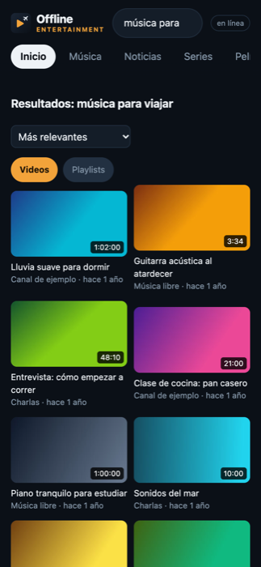
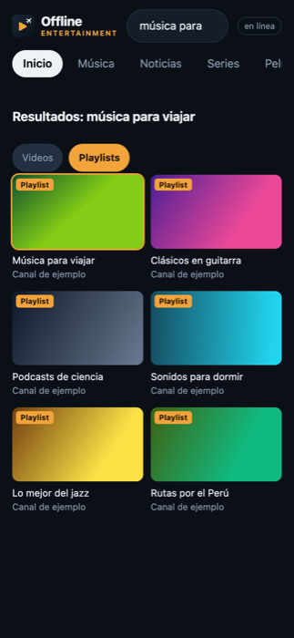
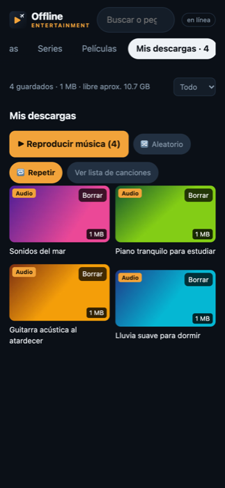
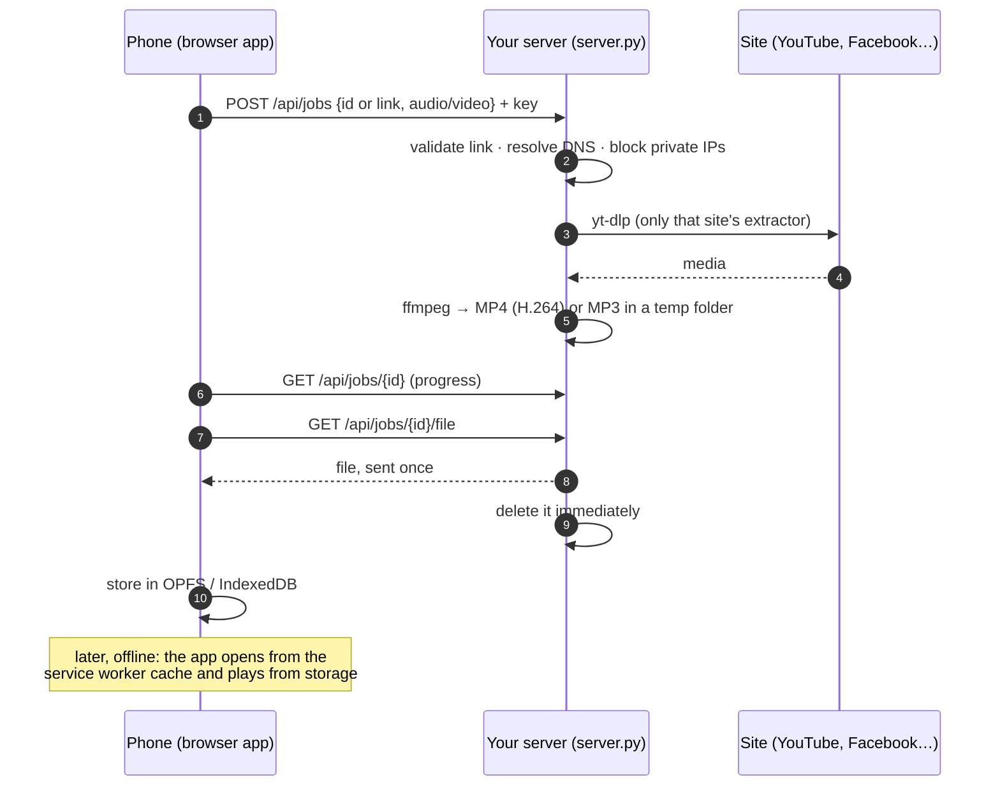
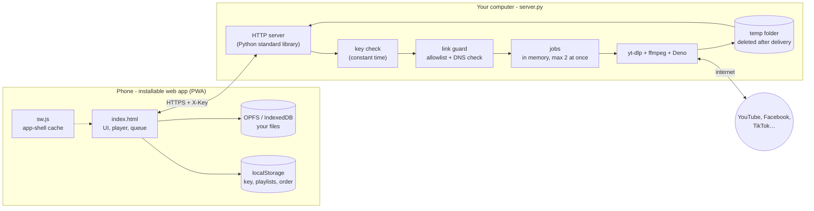

<p align="center">
  
</p>

<p align="center">
  <b>Your own in-flight entertainment.</b><br>
  Save videos and music to your phone and watch them in airplane mode.
</p>

<p align="center">
  <a href="https://github.com/azweig/offline-entertainment/actions/workflows/ci.yml"></a>
  <a href="https://github.com/azweig/offline-entertainment/actions/workflows/codeql.yml"></a>
  <a href="docs/security.md"></a>
  <a href="LICENSE"></a>
  
  
</p>

<p align="center"><b>English</b> · <a href="README.es.md">Español</a></p>

<p align="center">
  
  
  
</p>

Offline Entertainment is a small app you run on **your own computer** or **home server**. From your
phone you search or paste a link, and the video or song is stored **inside your phone's browser**.
Later, on a plane, a bus or anywhere without signal, you open the app and everything plays offline.

No accounts. No central service. No middlemen. The server keeps nothing.

---

## Contents

- [Documentation](#documentation)
- [Features](#features)
- [Supported sites](#supported-sites)
- [Quick start](#quick-start)
- [Using it from your phone](#using-it-from-your-phone)
- [How it works](#how-it-works)
- [Architecture](#architecture)
- [Security and privacy](#security-and-privacy)
- [Configuration](#configuration)
- [Updating yt-dlp](#updating-yt-dlp)
- [Limitations](#limitations)
- [Usage notice](#usage-notice)
- [Contributing](#contributing) · [Credits](#credits) · [License](#license)

## Documentation

| Guide | What's inside |
|---|---|
| [Self-hosting](docs/self-hosting.md) | Docker, systemd, Tailscale, reverse proxy (Caddy/nginx), keys, hardening checklist |
| [Architecture](docs/architecture.md) | C4 context/container/component diagrams, UML class, sequence and state diagrams, data map, limits |
| [HTTP API](docs/api.md) · [OpenAPI](docs/openapi.yaml) | Every endpoint, parameters, errors, curl example |
| [Security](docs/security.md) | Threat model (STRIDE), controls mapped to code and tests, security review, residual risks |
| [Development](docs/development.md) | Setup, `make` commands, conventions, adding a site, releasing |
| [Troubleshooting](docs/troubleshooting.md) | Common errors and FAQ |
| [Decisions (ADRs)](docs/adr/) | Why it is built this way |
| [Changelog](CHANGELOG.md) · [Security policy](SECURITY.md) · [Contributing](CONTRIBUTING.md) | |

## Features

**Find things to save**
- YouTube search with two tabs, **Videos** and **Playlists**, and sorting by newest or oldest.
- A home screen with Music, News, Series and Movies rows, plus **For you**: suggestions based on what
  you already saved (no account needed).
- An info sheet before saving: publish date, views, duration and description.
- Paste a link from YouTube or [10 other sites](#supported-sites): Facebook, Instagram, TikTok, X and more.

**Save**
- Video (360p, 480p or 720p, H.264 MP4 that plays on iPhone and Android) or audio only (MP3).
- Whole YouTube playlists or artists in audio with one tap. The queue survives reloads, retries when
  the server is busy and skips items that fail.
- Long videos are fine: the only limit is 1.2 GB per file.

**Play offline**
- With no internet the app opens straight into **My downloads**, in about 30 ms.
- A music player that works like a playlist: continuous play, shuffle, repeat, your own order, and
  lock-screen controls. Broken songs are skipped.
- Your own playlists, a filter by playlist, and "download the missing ones".
- Deleting anything asks for confirmation first.

## Supported sites

| Site | What you can paste |
|---|---|
| YouTube | Search, videos, Shorts, playlists and channels |
| Facebook | Public videos and reels |
| Instagram | Public reels and posts (from a carousel, the first video) |
| TikTok | Public videos |
| X (Twitter) | Public posts with video |
| Vimeo | Public videos that don't require login |
| SoundCloud | Single tracks |
| Dailymotion | Videos |
| Twitch | Clips and past broadcasts (not live streams) |
| Bandcamp | Single tracks |
| Internet Archive | Video and audio |

**Public content only.** Anything that needs a login, is private or is blocked in your country shows a
clear message and is not saved. Profiles, albums and lists from these sites are not accepted: paste
the link of one video or one song.

## Quick start

### On your computer (macOS, Linux, Windows)

Requirements: Python 3.11+, [ffmpeg](https://ffmpeg.org/) and [Deno](https://deno.com/). yt-dlp uses
Deno to read YouTube.

1. `git clone https://github.com/azweig/offline-entertainment && cd offline-entertainment`
2. Start it:
   - macOS / Linux: `make run` (or `./start.sh`)
   - Windows: double-click `start.bat`
3. Open the address printed in the terminal: `http://127.0.0.1:8765/#k=…`. That link already
   carries your key.

On first run a **random key** is created and saved with permissions 600 in
`~/.config/offline-entertainment/key` (Windows: `%APPDATA%\offline-entertainment\key`).
To use your own, set `OFFLINE_KEY` (12+ characters). There is always a key.

### With Docker

ffmpeg and Deno are included in the image.

1. `git clone https://github.com/azweig/offline-entertainment && cd offline-entertainment`
2. `make docker-up` (or `docker compose up -d --build`)
3. Open `http://127.0.0.1:8765` and type the key that `make key` prints.

Run `make` alone to see every shortcut: `make key`, `make update`, `make test`, `make check`…

The container writes no logs (`logging: none`).

## Using it from your phone

By default the server only listens on `127.0.0.1`, so only that computer can reach it.

**Option A: your home Wi-Fi (good for trying it out).** Start with `./start.sh --host 0.0.0.0`
(Docker: change the port to `"8765:8765"`). On the phone, open `http://<your-computer-ip>:8765`. You
can search and save, but **offline mode will not work over plain http**: phones only let a web app
open without internet when it is served over **HTTPS**.

**Option B: HTTPS with your own Tailscale (recommended).** [Tailscale](https://tailscale.com/) builds a
private network between your devices and gives you a real HTTPS certificate:

1. Install Tailscale on the computer and on the phone, signed in to the same account.
2. On the computer, keep the server on `127.0.0.1` and run `tailscale serve --bg 8765`.
3. On the phone, open `https://<machine>.<your-tailnet>.ts.net`, type your key and **add it to the
   home screen** (iPhone: Share → Add to Home Screen). On iPhone this also stops Safari from
   clearing what you saved.

Use `serve`, **not** `funnel`. `funnel` puts it on the public internet.

The computer must be on while you save things. To watch them later, it doesn't.

## How it works



1. The phone asks your server for a file, sending your key.
2. The server prepares it with yt-dlp and ffmpeg in a temporary folder.
3. It is sent to the phone and **deleted as soon as it has arrived complete**. If the transfer is
   cut (you switched apps, the signal dropped), the phone keeps what it received and asks only for
   the rest when you come back. Anything not collected within 60 minutes is deleted, and each run
   uses a new private temp folder that is removed when the server stops.
4. The phone keeps the file in its own storage. The service worker keeps the app itself, so it
   opens without a connection.

## Architecture



**Design choices**
- **One Python file, no framework.** `server.py` uses only the standard library plus yt-dlp, so it
  installs anywhere Python runs.
- **One HTML file, no build step.** `static/index.html` is plain HTML, CSS and JavaScript.
- **Your library lives on the phone, not on the server.** The server is a pass-through: it has no
  database, no history and no logs.
- **Offline first.** The service worker serves the app from cache (stale-while-revalidate) and never
  caches redirects or captive-portal pages. Connectivity is checked with a real request to
  `/api/ping`, not with `navigator.onLine`.
- **Files are stored with OPFS** (the browser's private file system), with IndexedDB as a fallback,
  and the app asks for persistent storage.

**Repository layout**

```
server.py              HTTP server, link guard, yt-dlp jobs
static/index.html      the whole app: UI, storage, player, download queue
static/sw.js           service worker (offline app shell)
static/manifest.webmanifest, icon.svg, *.png   installable app metadata and icons
tests/test_server.py   auth, key file, site allowlist, private-address blocking
start.sh / start.bat   one-command start for macOS/Linux and Windows
Dockerfile, docker-compose.yml
scripts/smoke.sh       real start-up check (key 600, 401 / 200, 404)
Makefile               run, test, lint, smoke, check, docker-up, key, update
docs/                  architecture, API + OpenAPI, security, self-hosting, ADRs
.github/               CI, CodeQL, Dependabot, issue forms, PR template
```

More diagrams (components, UML classes, every flow, job state machine, deployments) are in
[docs/architecture.md](docs/architecture.md).

**HTTP API.** Every `/api/*` call needs the `X-Key` header.

| Method and path | What it does |
|---|---|
| `GET /api/ping` | Checks the key and the connection |
| `GET /api/search?q=&n=&sort=` | YouTube video search (`sort`: `new` or `old`) |
| `GET /api/playlists?q=` | YouTube playlist search |
| `GET /api/info?id=` | Video info: date, views, description |
| `GET /api/related?id=` | Related videos (YouTube Mix), used by "For you" |
| `GET /api/channel?id=` | Latest videos from a channel |
| `GET /api/playlist?id=` · `GET /api/artist?id=` | Every item in a playlist or channel (up to 200) |
| `GET /api/link?url=` | Info for a link from another supported site |
| `GET /api/thumb?id=` | YouTube thumbnail, fetched through your server |
| `POST /api/jobs` | Starts a download: `{"id" or "url", "mode": "audio"/"video", "quality"}` |
| `GET /api/jobs/{id}` | Progress |
| `GET /api/jobs/{id}/file` | The file, once. Deleted right after |

## Security and privacy

- **A key is always required.** It is generated on first run (permissions 600) and compared in constant
  time. In the link `#k=…` it travels in the URL fragment, which browsers never send to the server.
  The app saves it and removes it from the address bar.
- **Listens on 127.0.0.1 by default.** Opening it to your network is an explicit choice (`--host`).
- **Links never reach yt-dlp as typed.** YouTube links are reduced to an 11-character ID and the URL is
  rebuilt on the server. For other sites there is a closed domain allowlist: the link is rebuilt
  (always https, no username or password, no port, no fragment) and yt-dlp loads **only that site's
  extractors, never the generic one** that would open any page.
- **Private networks are blocked, twice.** Before yt-dlp starts, the hostname is resolved and refused
  if it points to 127.0.0.0/8, 10/8, 172.16/12, 192.168/16, 169.254/16, 100.64/10, 0.0.0.0/8, ::1,
  fc00::/7, fe80::/10 and other private ranges. Then every socket the server opens is checked again
  at connect time, so redirects, media segments and DNS changes can't reach your home network either.
- **Hardened HTTP.** Strict Content-Security-Policy (only the app's own script, by hash), no framing,
  `nosniff`, 15-second request timeout, a cap on simultaneous connections, and a pause after
  repeated wrong keys.
- **Nothing is kept.** No database, history, titles or access logs. Files are deleted on delivery, and
  searches are cached in memory only, for 6 hours.
- **Bounded work.** At most 2 downloads at a time, 1.2 GB per file, 3 hours per job, and 200 items per
  playlist.
- **No block evasion.** There is no support for account cookies, proxies or browser impersonation, and
  none will be accepted.

The full threat model, the controls with links to the code and tests, and the latest review are in
[docs/security.md](docs/security.md). Found a vulnerability? Please follow [SECURITY.md](SECURITY.md)
(**Security → Report a vulnerability** on GitHub), not a public issue.

## Configuration

| Variable or flag | Default | Purpose |
|---|---|---|
| `--host` / `OFFLINE_HOST` | `127.0.0.1` | Use `0.0.0.0` to allow your home network |
| `--port` / `OFFLINE_PORT` | `8765` | Port |
| `OFFLINE_KEY` | generated | Your own key (12+ characters) |
| `OFFLINE_CONFIG_DIR` | `~/.config/offline-entertainment` | Where the generated key is stored |

## Updating yt-dlp

Sites change often and yt-dlp keeps up. If searching or saving stops working, update it first:

- macOS / Linux: `.venv/bin/pip install -U "yt-dlp[default]"`
- Windows: `.venv\Scripts\pip install -U "yt-dlp[default]"`
- Docker: `docker compose build --no-cache && docker compose up -d`

Then restart the server.

## Limitations

- It depends on [yt-dlp](https://github.com/yt-dlp/yt-dlp) and can stop working when a site changes,
  until a new version comes out. Facebook, Instagram, TikTok and X change often.
- **YouTube usually blocks datacenter IPs** (VPS, cloud: "Sign in to confirm you're not a bot"). It is
  meant for a home connection.
- Storage space depends on the phone's browser. On iPhone, install it to the home screen.

## Usage notice

This is a tool for **personal use**. You are responsible for respecting copyright and each site's
terms of service. Save only what you have the right to save.
**Please do not run public instances** or offer it as a service to other people.

## Contributing

Pull requests are welcome. See [CONTRIBUTING.md](CONTRIBUTING.md) and the
[development guide](docs/development.md). Before opening one, run what CI runs:

```bash
make setup   # once
make check   # lint + unit tests + real start-up check
```

## Credits

- [yt-dlp](https://github.com/yt-dlp/yt-dlp) (Unlicense) does all the extracting and downloading.
- [FFmpeg](https://ffmpeg.org/) (LGPL/GPL) converts audio and video.
- [Deno](https://deno.com/) (MIT) is the JavaScript runtime yt-dlp uses for YouTube.

## License

[MIT](LICENSE)
