# Architecture

This document describes how Offline Entertainment is built: the parts, how they talk to each other,
where data lives and why it was designed this way. All diagrams are [Mermaid](https://mermaid.js.org/)
and render directly on GitHub.

- [1. Goals and constraints](#1-goals-and-constraints)
- [2. System context](#2-system-context-c4-level-1)
- [3. Containers](#3-containers-c4-level-2)
- [4. Server components](#4-server-components-c4-level-3)
- [5. Static structure (UML class diagrams)](#5-static-structure-uml-class-diagrams)
- [6. Key flows (UML sequence diagrams)](#6-key-flows-uml-sequence-diagrams)
- [7. Job lifecycle (UML state machine)](#7-job-lifecycle-uml-state-machine)
- [8. Data: what is stored where](#8-data-what-is-stored-where)
- [9. Deployment views](#9-deployment-views)
- [10. Concurrency, limits and resource use](#10-concurrency-limits-and-resource-use)
- [11. Frontend internals](#11-frontend-internals)
- [12. Design decisions](#12-design-decisions)

---

## 1. Goals and constraints

| Goal | How the design meets it |
|---|---|
| Play saved videos and music with **no connection at all** | Files live in the phone's browser storage (OPFS/IndexedDB); a service worker serves the app shell offline. |
| **Self-hosted**, no central service | One process on the user's own computer or home server. No accounts, no telemetry, no third-party calls besides the content sites. |
| **Nothing kept on the server** | Files are prepared in a temp folder, sent once and deleted. No database, no history, no access logs. |
| **Safe to expose to a phone** | Mandatory key, `127.0.0.1` by default, link allowlist, DNS check against private networks before every connection. |
| **Easy to install and audit** | One Python file (stdlib + yt-dlp), one HTML file, no build step, no framework. |

**Non-goals** (rejected on purpose): account cookies or logins, proxies, browser impersonation, getting
around site blocks, public or multi-user instances.

## 2. System context (C4 level 1)

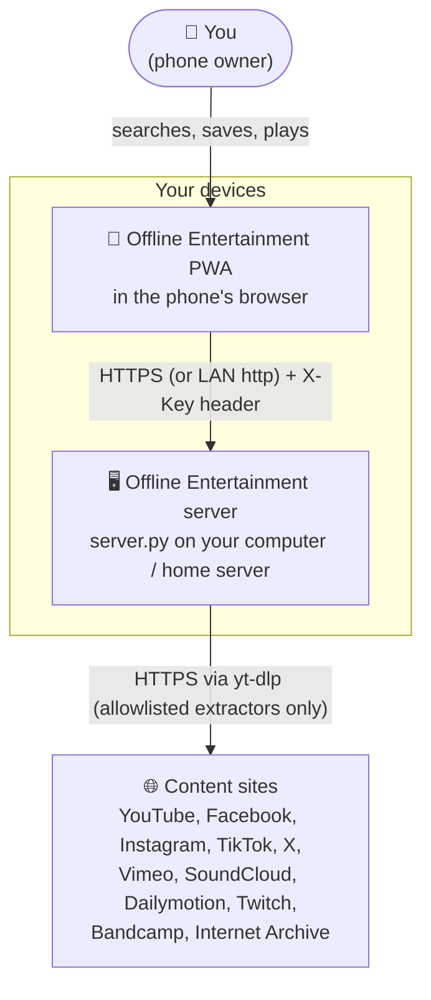

The phone **never talks to the content sites for media**: search results, info and files come through
your server. (Thumbnails in search results are loaded by the browser from `i.ytimg.com`; saved
thumbnails are fetched through the server.)

## 3. Containers (C4 level 2)

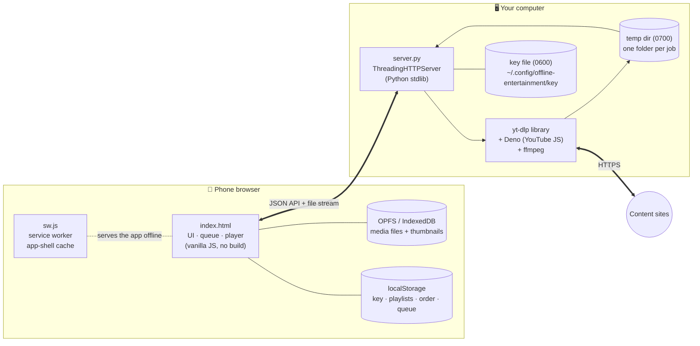

| Container | Technology | Responsibility |
|---|---|---|
| `static/index.html` | HTML + CSS + vanilla JS | Search, info sheet, download queue, library, music player, offline mode |
| `static/sw.js` | Service Worker | Stale-while-revalidate cache of the app shell; never caches `/api/` |
| Browser storage | OPFS (IndexedDB fallback), localStorage | The user's library and preferences. The only persistent copy of media. |
| `server.py` | Python 3.11+ stdlib `http.server` | Auth, input validation, link guard, job orchestration, one-time file delivery |
| yt-dlp + ffmpeg + Deno | Libraries / binaries | Extraction, download, remux to H.264 MP4 or convert to MP3 |

## 4. Server components (C4 level 3)

`server.py` is a single module, organised in clearly separated groups of functions:

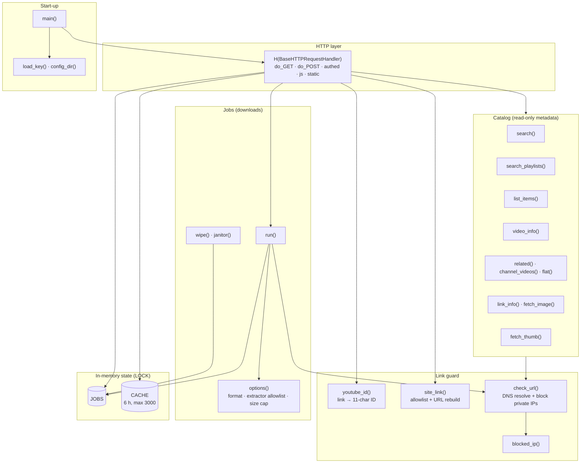

**Rule enforced across the code:** every outbound connection (`extract_info`, media format URLs,
`urlopen` for thumbnails) is preceded by `check_url()`, and every URL handed to yt-dlp is **built by the
server** from a validated ID or a rebuilt allowlisted link, never taken verbatim from the request.

## 5. Static structure (UML class diagrams)

### 5.1 Server

The server is procedural; the diagram groups functions into logical classes (stereotype `«module»`)
so the responsibilities and dependencies are easy to see.

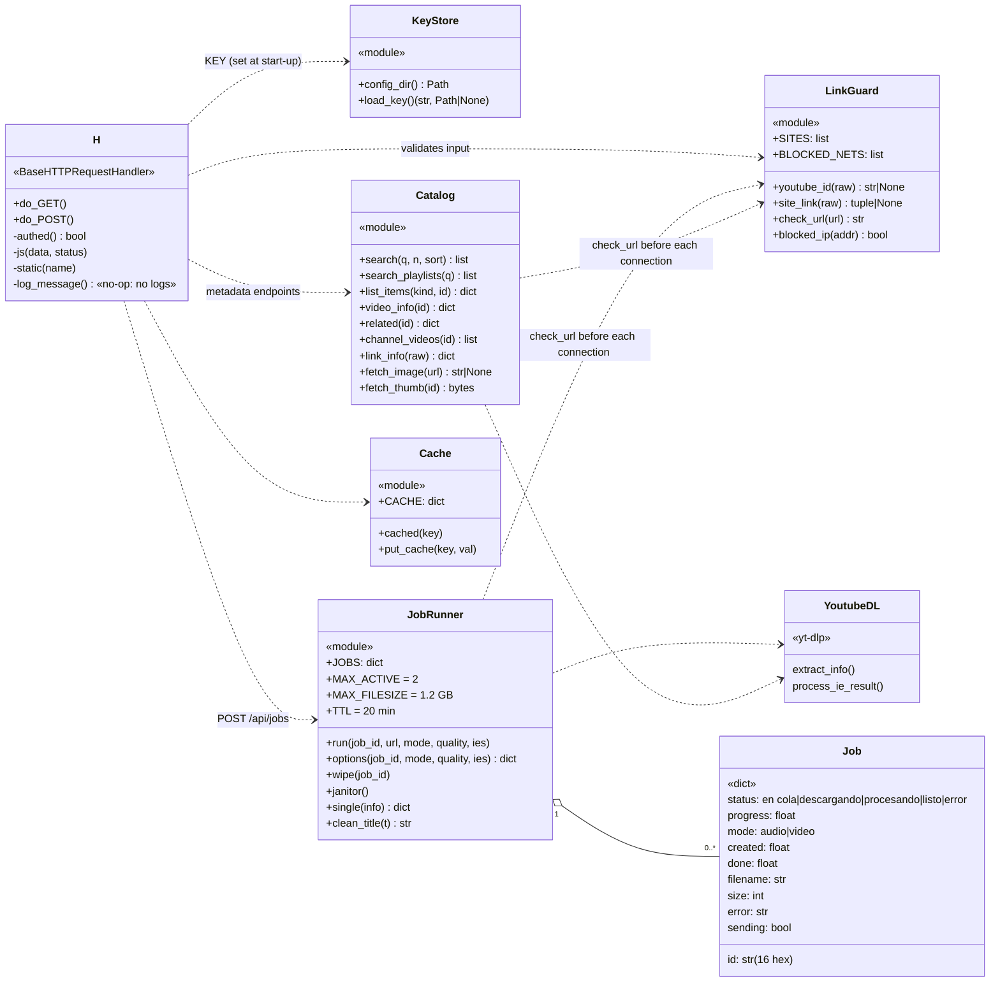

### 5.2 Frontend

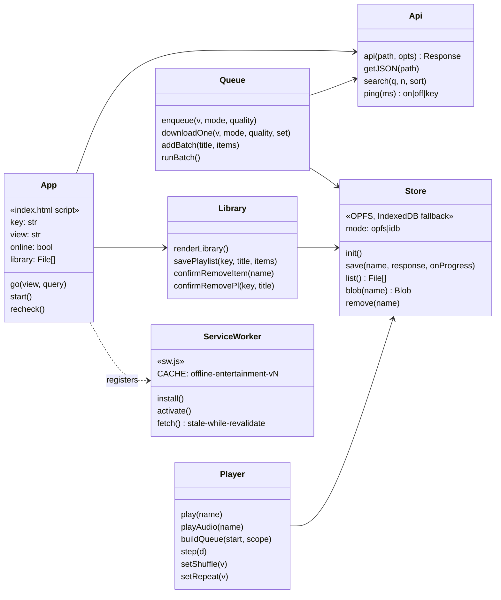

## 6. Key flows (UML sequence diagrams)

### 6.1 First start and key hand-off

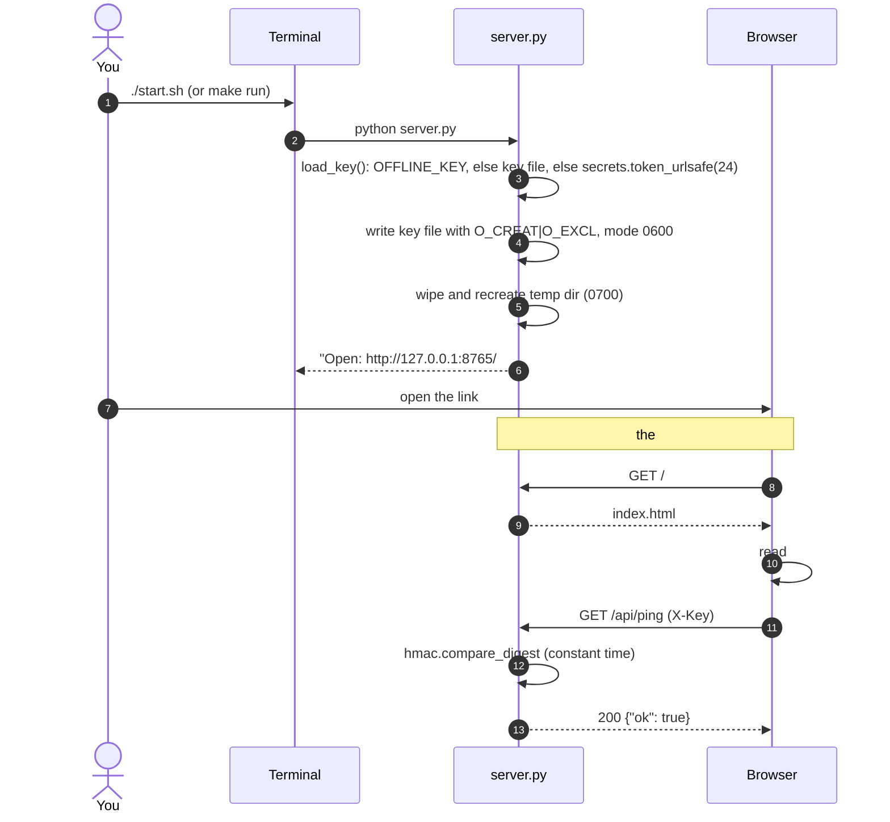

### 6.2 Saving a video (job)

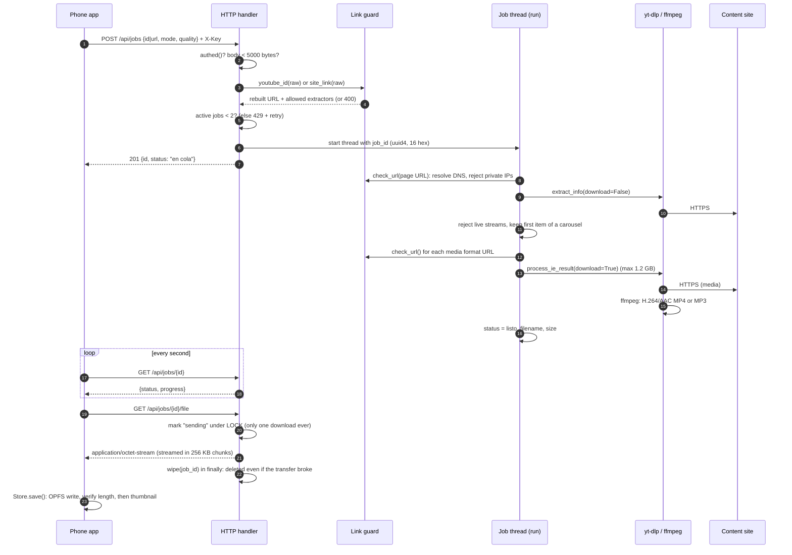

### 6.3 Link from another site (preview before saving)

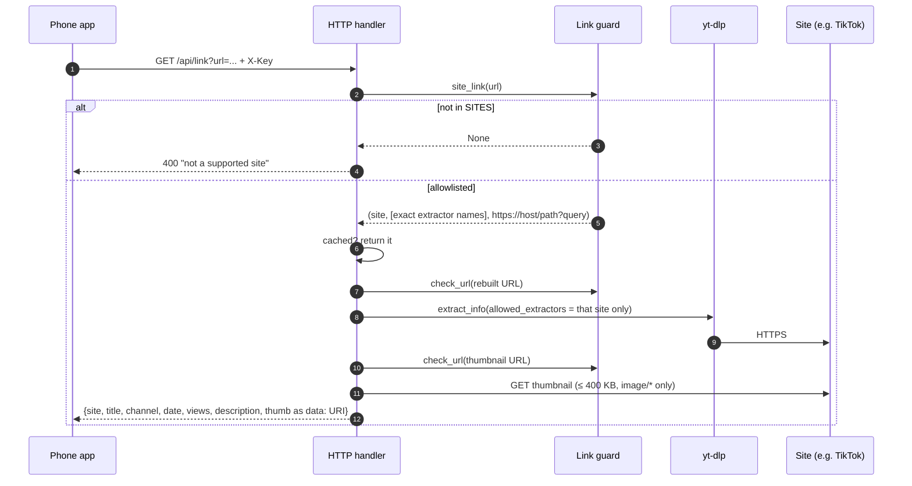

### 6.4 Opening the app with no connection

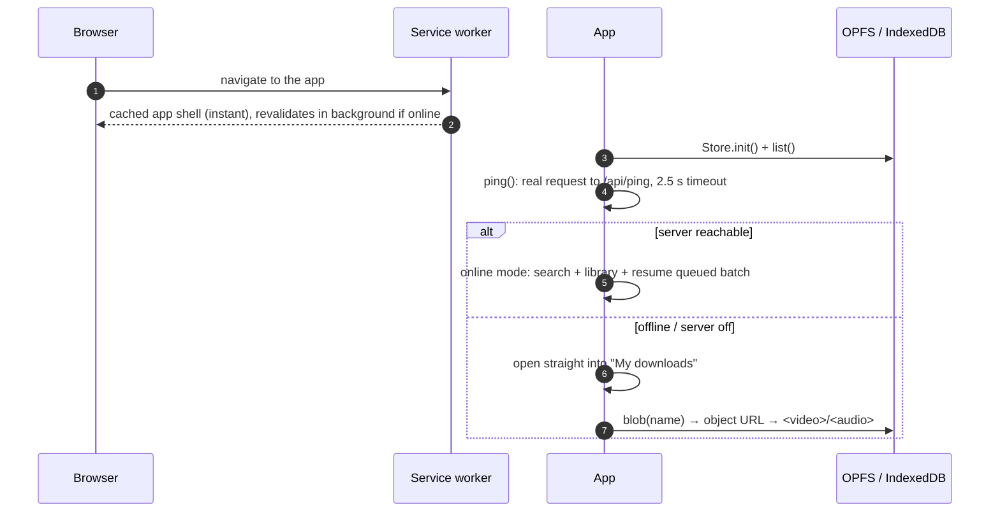

## 7. Job lifecycle (UML state machine)

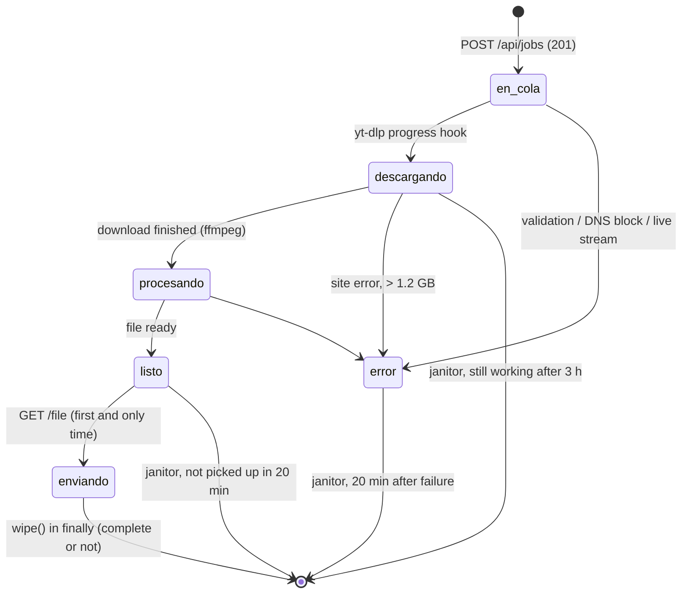

States are the Spanish strings the API returns: `en cola` (queued), `descargando` (downloading),
`procesando` (processing), `listo` (ready), `error`. `enviando` is the internal `sending` flag.

## 8. Data: what is stored where

| Data | Where | Lifetime | Who can read it |
|---|---|---|---|
| Key | Server: `OFFLINE_KEY` or key file (0600). Phone: `localStorage['vk']` | Until you change it | You |
| Media being prepared | Server temp dir `offline-entertainment-XXXX/<job>` (new per run, 0700) | Until delivered, max 20 min after ready, max 3 h working; removed when the server stops | Server process |
| Job metadata | Server memory (`JOBS`) | Same as above | Server process |
| Search / list / info results | Server memory (`CACHE`) | 6 h, max 3000 entries, lost on restart | Server process |
| Saved media + thumbnails | Phone: OPFS (`navigator.storage.getDirectory()`) or IndexedDB `offline-entertainment/files` | Until you delete it (persistent storage requested) | Only that browser profile |
| Playlists, song order, shuffle/repeat, pending batch | Phone: `localStorage` (`vpls`, `morder`, `mshuf`, `mrep`, `vbatch`) | Until you clear it | Only that browser profile |
| Access logs | **None** (`log_message` is a no-op; Docker `logging: none`) | — | — |

File names carry the source ID so the app can recommend and de-duplicate:
`Title [YouTubeID].mp4` for YouTube and `Title {Extractor id}.mp4` for other sites.

## 9. Deployment views

### 9.1 Local, this computer only (default)

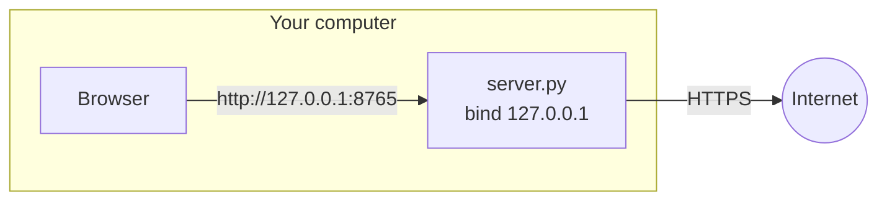

### 9.2 Phone over HTTPS with Tailscale (recommended)

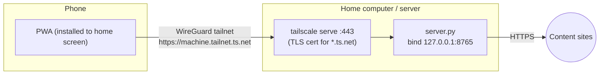

HTTPS matters: browsers only allow service workers (offline mode) and reliable persistent storage on
secure origins. `tailscale serve` keeps it private to your tailnet; `tailscale funnel` would publish it
to the internet and must not be used.

### 9.3 Docker

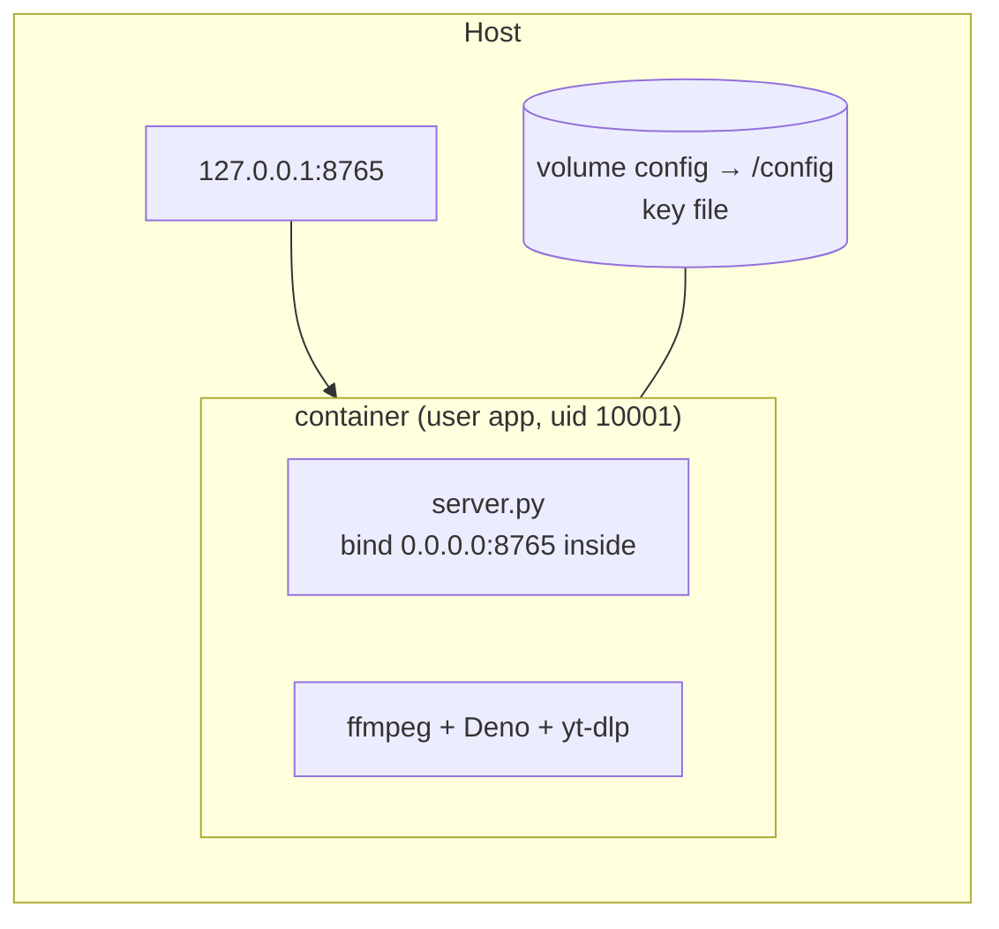

The container listens on all interfaces **inside** its network namespace, but `docker-compose.yml`
publishes the port only on the host's `127.0.0.1`. Logging driver is `none`; all capabilities are
dropped, `no-new-privileges` is set, and memory (1 GB) and processes (256) are capped.

### 9.4 Behind a reverse proxy

See [self-hosting.md](self-hosting.md#behind-a-reverse-proxy) for Caddy and nginx examples with the
recommended security headers. Keep the server bound to `127.0.0.1` and let only the proxy reach it.

## 10. Concurrency, limits and resource use

| Limit | Value | Where |
|---|---|---|
| Concurrent downloads | 2 (`MAX_ACTIVE`), extra requests get `429` with `retry: 10` | `do_POST` |
| File size | 1.2 GB (`MAX_FILESIZE`, enforced by yt-dlp) | `options()` |
| Job working time | 3 h (`MAX_WORK`) | `janitor()` |
| Pick-up window | 20 min after ready/failed (`TTL`) | `janitor()` |
| Playlist / channel size | 200 items (`MAX_LIST`) | `list_items()` |
| Search results | 24 (40 when sorting by date) | `do_GET`, `search()` |
| Request body | < 5000 bytes, JSON | `do_POST` |
| Thumbnail via `/api/link` | 400 KB, `image/jpeg|png|webp` only | `fetch_image()` |
| Metadata cache | 6 h, 3000 entries (evicts the oldest 1000) | `put_cache()` |

Threads: `ThreadingHTTPServer` gives one thread per connection; each job runs in its own daemon
thread; one janitor thread runs every 30 s. Shared state (`JOBS`, `CACHE`) is only touched under
`LOCK`.

## 11. Frontend internals

- **No build, no framework.** One `<script>` in `index.html`. Every string that comes from a site
  (titles, channels, descriptions) is rendered through `esc()` or `textContent`.
- **Storage.** `Store` probes OPFS with a real write (`createWritable`); if that fails it falls back to
  IndexedDB. Downloads stream straight to disk and are verified against `Content-Length`; partial
  files are removed.
- **Connectivity.** `navigator.onLine` only says whether there is Wi-Fi/data, so the app pings its own
  server (`/api/ping`, 2.5 s timeout) on start, on `online` and when the tab becomes visible.
- **Queue.** Single downloads run one after another (`enqueue`). Playlists and artists use a batch
  (`addBatch`/`runBatch`) persisted in `localStorage`, so it resumes after the app is closed, waits
  when the server answers `429` and skips items that fail.
- **Player.** Continuous play, shuffle, repeat and custom order; Media Session API for lock-screen
  controls; broken files are skipped.
- **Service worker.** Stale-while-revalidate for the app shell, never for `/api/`; does not cache
  redirects or opaque responses (captive portals). Bump `CACHE` in `sw.js` when the shell changes.

## 12. Design decisions

Recorded as short Architecture Decision Records in [`docs/adr/`](adr/):

| ADR | Decision |
|---|---|
| [0001](adr/0001-single-file-stdlib-server.md) | One Python file using only the standard library (plus yt-dlp) |
| [0002](adr/0002-library-lives-on-the-phone.md) | The library lives on the phone; the server is a pass-through |
| [0003](adr/0003-extractor-allowlist-and-dns-guard.md) | Closed site allowlist, exact extractors and a DNS guard against private networks |
| [0004](adr/0004-mandatory-key-in-url-fragment.md) | A key is always required; it is handed over in the URL fragment |
| [0005](adr/0005-no-accounts-cookies-or-evasion.md) | No accounts, cookies, proxies or block evasion |
