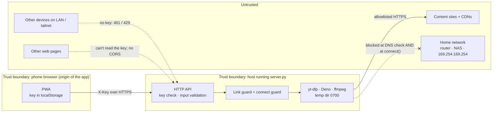

# Security

This document is the security model of Offline Entertainment: what it protects, from whom, how, how
each control is tested, what the last review found and what risk remains. To report a vulnerability,
see [SECURITY.md](../SECURITY.md).

- [1. Scope and assets](#1-scope-and-assets)
- [2. Actors and trust boundaries](#2-actors-and-trust-boundaries)
- [3. Threat model (STRIDE)](#3-threat-model-stride)
- [4. Controls, code and tests](#4-controls-code-and-tests)
- [5. Security review, 2026-11-15](#5-security-review-2026-11-15)
- [6. Residual risks](#6-residual-risks)
- [7. Operator checklist](#7-operator-checklist)
- [8. Automated security checks](#8-automated-security-checks)

## 1. Scope and assets

| Asset | Why it matters |
|---|---|
| **The key** | Whoever has it can make the server download things and use its bandwidth and disk. |
| **The home network** behind the server | A downloader is a natural SSRF tool: it must never reach the router, NAS, cloud metadata or other internal services. |
| **The host** (files, CPU, disk) | Jobs run yt-dlp, Deno and ffmpeg on untrusted content. |
| **What the user saved and searched** | Private: the server must not keep titles, history or logs. |
| **The phone's library** | Lives in the browser; must not be readable or modifiable by other sites. |

## 2. Actors and trust boundaries

| Actor | Trust | Capabilities |
|---|---|---|
| Owner (has the key) | Trusted | Uses the API from the phone |
| Device on the same network / tailnet (no key) | Untrusted | Can reach the port if the owner exposed it |
| Malicious web page open in the owner's browser | Untrusted | Can make the browser send requests, but can't read the key |
| Content sites and their CDNs | Untrusted | Control every byte of metadata and media, can redirect |
| Someone who crafts a link for the owner to paste | Untrusted | Controls the URL the server will process |

## 3. Threat model (STRIDE)

| # | Threat | Category | Mitigation | Status |
|---|---|---|---|---|
| T1 | Use the API without the key | Spoofing | Mandatory key, constant-time compare, no key-less mode | ✅ Mitigated |
| T2 | Guess the key online | Spoofing | 190-bit generated key; 12-char minimum for custom keys; 20 wrong keys in 10 min from one IP → `429` | ✅ Mitigated |
| T3 | Steal the key in transit | Information disclosure | HTTPS recommended (Tailscale/proxy); key in a header, never in URLs sent to the server (`#k=` fragment) | ⚠️ Plain-http LAN mode documented as a trade-off |
| T4 | Steal the key from logs | Information disclosure | Key printed only to an interactive terminal; no access logs; errors never printed | ✅ Mitigated |
| T5 | CSRF / cross-site use of the API | Spoofing, tampering | Custom header (not a cookie), no CORS headers, preflights rejected | ✅ Mitigated |
| T6 | DNS rebinding against the server | Spoofing | Rebound origin cannot read the key; API needs `X-Key` | ✅ Mitigated |
| T7 | SSRF to the home network via a pasted link | Elevation of privilege | Site allowlist, strict host syntax, URL rebuilt, exact extractors, DNS check, **connect-time guard** | ✅ Mitigated (see review M1, M3) |
| T8 | SSRF via redirects, HLS/DASH segments, DNS changes | Elevation of privilege | Connect-time guard on every socket; no redirects for thumbnails; native HLS downloader | ✅ Mitigated |
| T9 | Path traversal (static files, job IDs, filenames) | Tampering, information disclosure | Fixed list of static files; job IDs `[0-9a-f]{16}`; filenames from `iterdir()` of the job folder | ✅ Mitigated |
| T10 | XSS from titles/descriptions of remote content | Tampering | `esc()` / `textContent` everywhere; strict CSP: the inline script by hash plus same-origin files only (`i18n.js`, `i18n-dict.js`, `retro.js`), never inline handlers or remote scripts; thumbnails as checked `data:` URIs | ✅ Mitigated |
| T11 | Clickjacking | Tampering | `frame-ancestors 'none'`, `X-Frame-Options: DENY` | ✅ Mitigated |
| T12 | Exhaust threads with idle connections (slowloris) | Denial of service | 15 s request timeout, max 64 simultaneous connections | ⚠️ Reduced (see residual risks) |
| T13 | Fill the disk | Denial of service | 1.2 GB per job counting every stream and fragment, 2 jobs, 3 GB free-space floor, 60 min pick-up/resume window, 60 s stalled-transfer timeout, temp dir removed on exit | ✅ Mitigated |
| T14 | Runaway jobs | Denial of service | 3 h limit enforced inside the download; the 2-job limit counts live threads | ✅ Mitigated |
| T15 | Another local user hijacks the temp dir | Tampering | New `mkdtemp` folder (0700) per run | ✅ Mitigated |
| T16 | Server keeps a record of what was watched | Information disclosure | No database, history or logs; files deleted on delivery | ✅ Mitigated |
| T17 | Compromised dependency or CI action | Tampering | Few dependencies, pip-audit, Dependabot, actions pinned by SHA, checksummed tools, CodeQL | ⚠️ Reduced |
| T18 | Malicious media exploits ffmpeg/Deno | Elevation of privilege | Non-root user, Docker with no capabilities; Deno runs with no permissions (yt-dlp default) | ⚠️ Depends on upstream |
| T19 | Someone with the unlocked phone | Information disclosure | Out of scope (physical access) | — |

## 4. Controls, code and tests

| Control | Code (`server.py` unless noted) | Test |
|---|---|---|
| Mandatory key, constant-time compare | `H.authed`, `H.check_key` | `test_ping_*`, `test_todas_las_api_piden_clave`, `test_sin_clave_definida_nadie_entra`, `scripts/smoke.sh` |
| Generated key, 0600, `O_EXCL`, permission repair | `load_key` | `test_genera_y_reusa_clave_600`, `test_clave_corta_rechazada`, smoke |
| Wrong-key lockout | `H.locked_out`, `FAIL_LIMIT` | `test_muchas_claves_malas_429` |
| Key only in fragment and terminal | `main` (TTY check), `index.html` (`#k=` handler) | manual |
| Site allowlist + strict host + URL rebuild | `site_link`, `HOST_RE` | `test_aceptados_y_limpios`, `test_rechazados`, `test_barra_invertida_no_engana_al_filtro`, `test_solo_sitios_de_la_lista` |
| YouTube reduced to an ID | `youtube_id`, `do_POST` | `test_solo_sitios_de_la_lista` |
| Exact extractors, never `generic` | `options`, `link_info`, `YT_IES` in every `YoutubeDL` | `test_solo_extractores_del_sitio`, `test_todas_las_busquedas_solo_con_youtube` |
| DNS check before connecting | `check_url`, `blocked_ip`, `BLOCKED_NETS` | `test_bloqueadas`, `test_publicas`, `test_resuelve_antes_de_conectar`, `test_descarga_no_arranca_si_dns_apunta_adentro` |
| Connect-time guard (all sockets) | `guarded_connect`, `install_connect_guard` | `test_guardia_de_conexion` |
| No redirects for images | `NoRedirect`, `OPENER` | review |
| Native HLS (no ffmpeg networking) | `options` (`hls_prefer_native`) | review |
| Input validation | regexes `YT_ID`, `LIST_ID`, `CHAN_ID`, `HANDLE`, job ID; `n` clamped; body < 5000 bytes, JSON object only | `test_n_fuera_de_rango_no_llega_a_ytdlp`, `test_cuerpo_roto_400_sin_cortar` |
| Static files from a fixed list | `do_GET` | smoke (`404` on traversal) |
| Security headers + CSP with script hash | `SECURITY_HEADERS`, `csp`, `H.end_headers`, `H.static` | `test_cabeceras_de_seguridad_y_csp` |
| Request timeout + connection cap + silent errors | `H.timeout`, `Server`, `MAX_CONN` | manual (80 idle sockets: closed after 15 s, service recovers) |
| Size, time, concurrency and disk limits | `options` hook, `ACTIVE`, `MIN_FREE`, `janitor` | `test_corta_si_pasa_el_tope_de_tamano`, `test_limite_de_descargas_cuenta_hilos` |
| One-time delivery, delete in `finally` | `do_GET` (`/file`), `wipe` | review |
| Private temp dir, removed on exit | `main` (`mkdtemp`, SIGTERM handler) | manual |
| No logs | `H.log_message`, `Server.handle_error`, Docker `logging: none` | review |
| Frontend escaping | `esc()` in `static/index.html`; no inline handlers | CSP test, review of every `innerHTML` sink |
| Service worker never caches the API or redirects | `static/sw.js` | review |
| Container hardening | `Dockerfile` (uid 10001), `docker-compose.yml` (`cap_drop: ALL`, `no-new-privileges`, limits, 127.0.0.1) | CI `docker` job |

## 5. Security review, 2026-11-15

An independent reviewer (separate from the author of the code) audited every tracked file and the git
history, ran the test suite, and probed a running server. It found **no Critical or High issues**.
Every finding was fixed in v1.0.0:

| ID | Severity | Finding | Fix |
|---|---|---|---|
| M1 | Medium | A backslash in the host (`https://localhost\x.bandcamp.com/…`) passed the allowlist: Python saw a Bandcamp host while the HTTP library connected to `localhost`. | Reject `\`, `%`, `@` and whitespace in the authority; host must match a strict DNS-name pattern. Test added. |
| M2 | Medium | No request timeout: thousands of idle connections exhausted the server's threads, without the key. | 15 s request timeout; at most 64 simultaneous connections; extras are closed. Verified with 80 idle sockets. |
| M3 | Medium | The DNS check ran once and not on redirects, extractor API calls, HLS/DASH segments or DNS changes; the README overstated it. | Connect-time guard on every outbound socket in the process, image fetches without redirects, native HLS downloader. README corrected. |
| L1 | Low | Jobs dropped by the janitor kept running and stopped counting toward the 2-job limit. | The download aborts from the progress hook; the limit counts live threads. |
| L2 | Low | The 1.2 GB cap only applied to plain HTTP downloads with a known size. | The hook sums every stream and fragment and aborts above the cap; jobs are refused below 3 GB free. |
| L3 | Low | Fixed temp path in `/tmp` could be pre-created by another local user (start-up failure). | `mkdtemp` per run, removed on exit. |
| L4 | Low | No security headers; the app could be framed. | CSP with the script's SHA-256, `frame-ancestors 'none'`, `nosniff`, `Referrer-Policy`, `X-Frame-Options`, COOP; inline handlers removed. |
| L5 | Low | Unlimited online key guessing; plain-http LAN mode exposes the key. | Lockout after 20 wrong keys per IP in 10 min; LAN trade-off documented. |
| L6 | Low | Docker bind mount was root-owned on Linux (restart loop); no container hardening. | Named volume; `cap_drop: ALL`, `no-new-privileges`, memory and PID limits. |
| L7 | Low | CI actions pinned by tag; gitleaks downloaded without a checksum. | Actions pinned by commit SHA; gitleaks verified with SHA-256. |
| I1 | Info | Malformed bodies printed tracebacks (with the client IP) to stderr. | `400` for malformed bodies; server errors are never printed. |
| I2 | Info | `n=0` reached yt-dlp's generic extractor path (not exploitable). | `n` clamped to 1–24; every `YoutubeDL` restricted to YouTube extractors. |
| I3 | Info | An existing key file with open permissions was accepted silently. | Permissions are reset to 0600 with a warning. |
| I4 | Info | `fec0::/10`, NAT64 and 6to4 ranges depended on the Python version. | Added explicitly to `BLOCKED_NETS`. |
| I5 | Info | Job limit used two separate locks (theoretical race). | One locked block checks and reserves the slot. |

## 6. Residual risks

| Risk | Why it remains | Guidance |
|---|---|---|
| Thumbnails in search results load from `i.ytimg.com` | Proxying every thumbnail would need the key in image URLs or much more server traffic. Google sees the phone's IP (no referrer is sent). | Saved items use thumbnails fetched by the server. |
| Connection-cap DoS by an unauthenticated device that can reach the port | A cap is the trade-off for a stdlib server; the attack only lasts while it continues and leaks nothing. | Don't expose the port beyond your tailnet; put a proxy with rate limiting in front if internet-facing. |
| Plain-http LAN mode sends the key in clear text | Some people try it on home Wi-Fi first. | Use Tailscale `serve` or a TLS proxy; rotate the key if you used open Wi-Fi. |
| Subprocesses (ffmpeg, Deno) are not covered by the connect guard | They run in other processes. ffmpeg only processes local files here; Deno runs with no network permission. | Keep `hls_prefer_native`; don't configure external downloaders. |
| Large upstream attack surface (yt-dlp, ffmpeg, Deno) parsing untrusted content | Inherent to the purpose. | Run as non-root / in Docker; keep them updated (`make update`, Dependabot). |
| Docker base images pinned by tag, not digest; root filesystem writable | Simpler updates for end users. | Dependabot watches the base images; you can add `read_only: true` with a writable `/tmp` volume. |
| Anyone with the unlocked phone can use the app | The key is stored in the browser for convenience. | Lock your phone; rotate the key if a phone is lost. |

## 7. Operator checklist

See the [hardening checklist](self-hosting.md#hardening-checklist) in the self-hosting guide. In short:
keep it on `127.0.0.1` behind Tailscale `serve` or a TLS proxy, run it as a normal user, keep the
generated key, disable proxy access logs and update yt-dlp regularly.

## 8. Automated security checks

| Check | Where | When |
|---|---|---|
| Unit tests for every control above | `tests/test_server.py` | every push and PR (Python 3.11, 3.13) |
| Real start-up check (key 0600, 401/200, traversal 404) | `scripts/smoke.sh` | every push and PR |
| Static analysis with security rules (bandit set) | `ruff` (`S` rules) | every push and PR |
| CodeQL `security-extended` for Python and JavaScript | `.github/workflows/codeql.yml` | every push, PR and weekly |
| Known vulnerabilities in dependencies | `pip-audit` | every push and PR |
| Secrets in the whole git history | `gitleaks` (checksum-verified) | every push and PR |
| Container runs as non-root, hardened flags, 401 without key | CI `docker` job | every push and PR |
| Dependency and action updates | Dependabot | weekly / monthly |
| Private vulnerability reporting | GitHub Security Advisories | always on |
